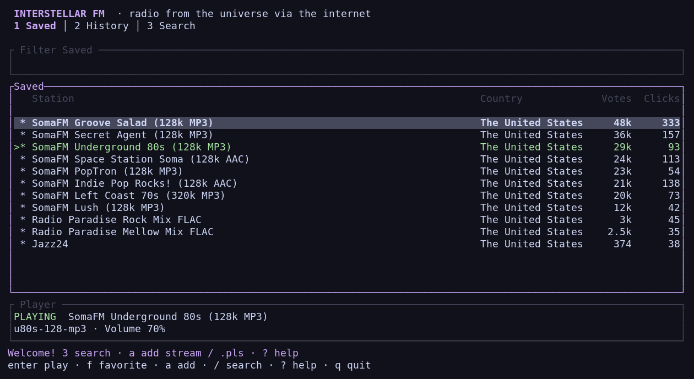
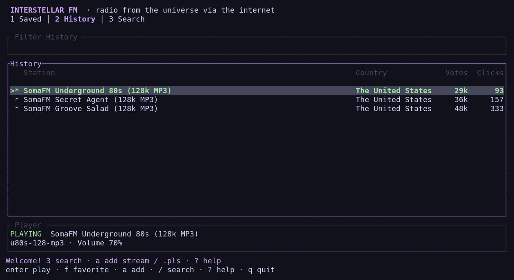
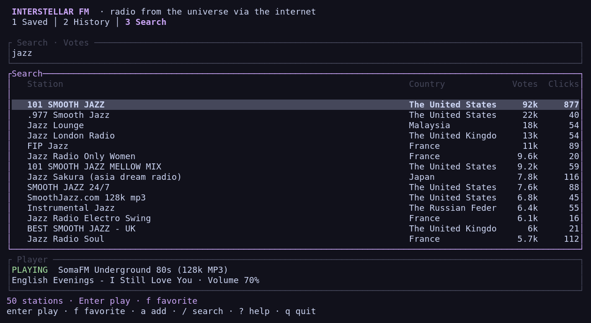

# Interstellar FM CLI

*radio from the universe via the internet*

A keyboard-first internet radio player for your terminal. Discover stations with
[Radio Browser](https://www.radio-browser.info/), save favorites, revisit your
listening history, or add a stream URL or `.pls` playlist directly.

## Screenshots

**Saved**



<details>
<summary>History</summary>



</details>

<details>
<summary>Search</summary>



</details>

Captured from the running app with public stations in an isolated demo library.

## Install and run

Requires **Linux**, a current stable [Rust toolchain](https://rustup.rs/), and
[mpv](https://mpv.io/) in your `PATH` (`sudo pacman -S mpv` or `sudo apt install mpv`).

Build from a checkout and copy the binary to a standard user-local location:

```bash
cargo build --release --locked
install -Dm755 target/release/interstellarfm-cli "$HOME/.local/bin/interstellarfm-cli"
```

Add these lines to `~/.bashrc` (Bash) or `~/.zshrc` (Zsh), then open a new terminal:

```bash
export PATH="$HOME/.local/bin:$PATH"
alias ifm='interstellarfm-cli'
```

For **Fish**, run these once to persist the PATH entry and `ifm` alias:

```fish
fish_add_path "$HOME/.local/bin"
alias --save ifm interstellarfm-cli
```

Launch with **`ifm`** or `interstellarfm-cli`. Alternatively,
`cargo install --locked --path .` installs to `~/.cargo/bin`.
Run without installing: `cargo run --release`.

## Controls

| Action | Keys |
| --- | --- |
| Saved / History / Search | `1` / `2` / `3` |
| Previous / next tab | Left / Right or `h` / `l` |
| Navigate stations | Up / Down or `j` / `k` |
| Search / filter; return to results | `/`, then `Tab` |
| Play selected; pause / resume | `Enter`; `p` or Space |
| Favorite / unfavorite; remove from Saved | `f`; `d` |
| Add stream URL or `.pls` | `a` |
| Volume; mute | `+` / `-` or `v` / `V`; `m` |
| Cycle sort; reverse order | `o`; `O` |
| Station details; all controls | `i`; `?` |
| Quit | `q` or `Ctrl-c` |

Sort by **Clicks, Name, Click trend, or Votes** (default). Counts are compact
(`23k`, `2.3k`); station details show exact values. Clicks are not listener counts.

## Configuration

Copy [`config.example.toml`](config.example.toml) to
`~/.config/interstellarfm-cli/config.toml` to customize shortcuts, color, and settings.
Run `interstellarfm-cli --help` for options or `--check` for diagnostics.

See the [usage guide](docs/usage.md) for playlist imports, saved-data locations,
and playback details. For development and tests, see [Contributing](CONTRIBUTING.md).

## License

Released under the [MIT License](LICENSE).
Discovery is provided by Radio Browser; playback uses mpv.
